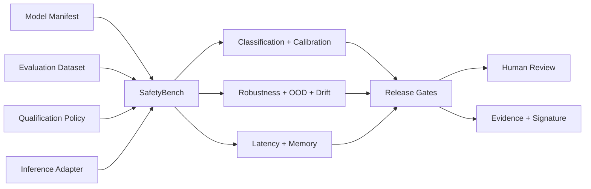

# EdgeAI SafetyBench

An evidence-driven qualification workbench for automotive edge-AI models. It evaluates classification quality, calibration, robustness, out-of-distribution confidence, group consistency, latency and memory against explicit release gates.

> SafetyBench supports engineering review. It does not automatically certify a model, prove functional safety, or authorize vehicle control.

## Implemented

- versioned model manifest with intended use, target, precision, features, labels, dataset lineage and limitations
- bounded labelled dataset validation
- pluggable inference adapter contract and deterministic linear-classifier reference
- accuracy, per-class precision/recall/F1, macro F1 and confusion matrix
- expected calibration error
- group accuracy and maximum group gap
- OOD confidence statistics
- latency P50/P95/maximum and adapter memory estimate
- deterministic robustness campaigns: Gaussian noise, bias, dropped feature and scaling
- population stability index for distribution drift
- explicit pass/fail gates and `eligible-for-human-review` decision
- baseline/candidate comparison
- SHA-256 evidence integrity plus optional RSA-SHA256 evidence signatures
- bounded loopback REST API, optional bearer authentication and browser console
- synthetic automotive battery-anomaly qualification demonstration
- **36 dependency-free runtime tests**

## Quick start

Requires Node.js 20 or later.

```bash
npm test
npm run demo
npm start
```

Open <http://127.0.0.1:8081>. Set `API_TOKEN` from a secret manager to require bearer authentication. Never commit tokens or private keys.

## API

| Method | Path | Purpose |
|---|---|---|
| GET | `/api/health` | Runtime health |
| GET | `/api/example` | Complete model, dataset and policy fixture |
| POST | `/api/qualifications` | Execute qualification campaign |
| GET | `/api/qualifications/{id}` | Retrieve report |
| GET | `/api/qualifications/{id}/evidence` | Retrieve evidence envelope |
| POST | `/api/evidence/verify` | Verify SHA-256 integrity |
| POST | `/api/compare` | Compare two retained reports |

Bodies are limited to **2,000,000 bytes**, datasets to **100,000 samples**, features to **1,024**, labels to **1,000**, and retained runs to **100**.

## Architecture



The domain engine does not depend on ONNX Runtime, TensorRT, TFLite, cloud services or vehicle hardware. Those runtimes belong in replaceable adapters. See [architecture](docs/architecture.md), [threat model](docs/threat-model.md), and [qualification policy](docs/qualification-policy.md).

## Evidence interpretation

`eligible-for-human-review` means every configured automated gate passed. A qualified reviewer must still assess model purpose, data adequacy, operational design domain, hazards, cybersecurity, explainability, target hardware, integration tests and change impact. A failed gate produces `rejected`.

## Honest roadmap

ONNX Runtime, TensorRT, TFLite, Qualcomm/NVIDIA targets, image datasets, adversarial attacks, explainability, dataset bias analysis beyond group accuracy, model conversion, hardware power measurements, MLflow, immutable evidence storage, OIDC and tenant isolation are not yet implemented.

## Security, safety and licensing

The server binds to loopback, emits restrictive browser headers, validates bounded inputs and supports bearer authentication. Private keys are accepted only by the offline evidence-signing function and are never persisted. See [SECURITY.md](SECURITY.md).

This version is proprietary and source-available. Production, commercial, customer, vehicle, embedded-system or field use requires a separate written commercial license. See [LICENSE](LICENSE) or contact `nagaraj.rbhagwat@expleogroup.com` or an authorized Expleo Group representative. Earlier versions validly released under prior terms retain those grants.
